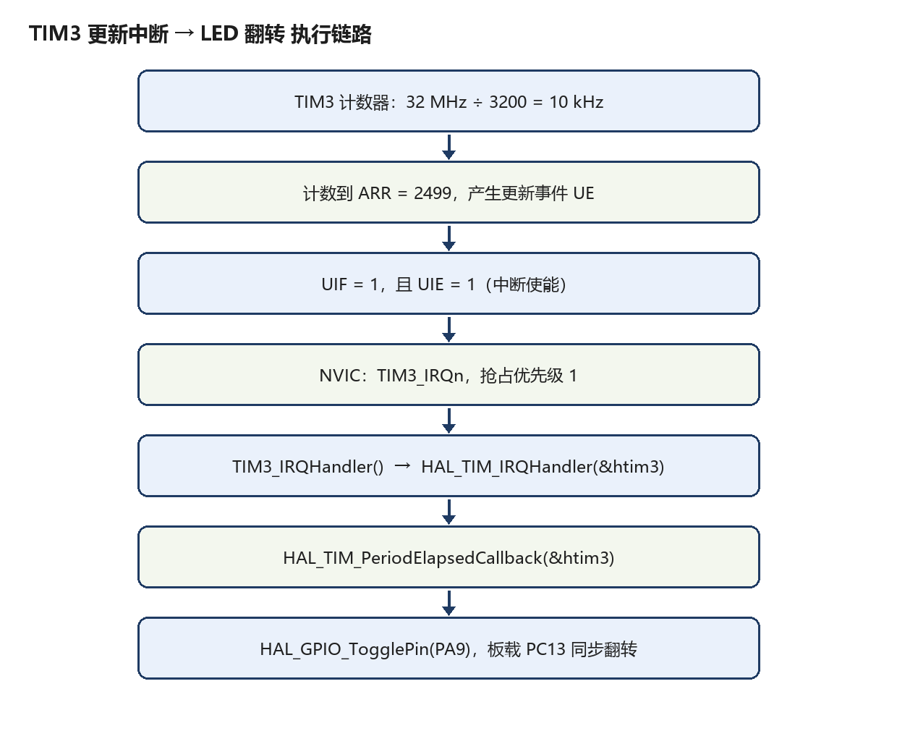
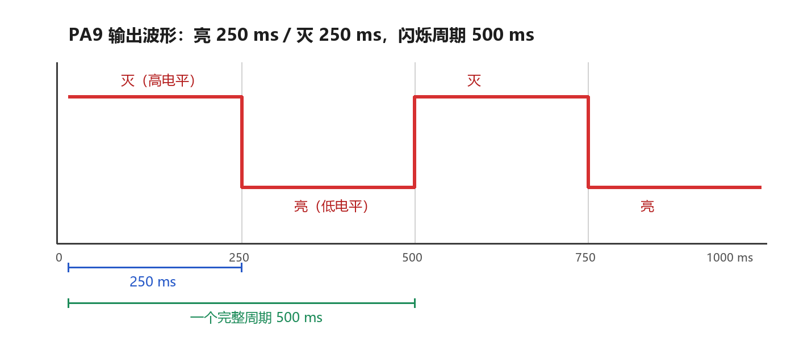

# STM32F103C8T6 外接 LED 500 ms 周期闪烁实验报告

**实验平台**：STM32F103C8T6 最小系统板（LQFP48）+ ST-Link 调试器

**开发工具**：STM32CubeMX 6.18.1、Keil MDK 5.32（ARMCC V5.06 update 7）、STM32Cube FW_F1 V1.8.7

**实验目标**：让外接 LED 以 500 ms 为周期闪烁，延时全部由中断完成，主程序全程不被阻塞，不使用 `HAL_Delay()`、`HAL_GetTick()` 等任何阻塞式延时。

---

## 一、任务分析与设计口径

题目要求“500 ms 周期闪烁”并“使用中断进行延时”。本设计把时间基准交给 TIM3：

- TIM3 每 **250 ms** 产生一次更新中断；
- 中断服务函数里**只翻转一次 GPIO**，不做任何等待；
- 亮 250 ms、灭 250 ms，两次翻转合成一个 **500 ms 的完整周期**；
- `while (1)` 主循环空转，CPU 不轮询、不等待，随时可以去做别的事。

> 口径说明：如果你的老师把“500 ms 周期”理解为“每 500 ms 翻转一次”（一个完整周期 1 s），把代码里的 `LED_TOGGLE_MS` 从 `250U` 改成 `500U` 即可，其余不用动。

---

## 二、总体设计

### 2.1 为什么不能用 HAL_Delay / HAL_GetTick

`HAL_Delay()` 的本质是 `while ((HAL_GetTick() - start) < ms);`——CPU 原地空转，等 `uwTick` 被 SysTick 中断加一。它带来三个问题：

1. **CPU 被占死**：延时期间做不了任何事，多任务无从谈起；
2. **依赖中断**：一旦关中断，或者把它放在高优先级中断里调用，就会永久卡死；
3. **精度受节拍限制**：只有 1 ms 粒度，且中断响应有抖动。

用定时器中断的“延时”则完全不同：**时间由硬件计数器负责，CPU 只在到点的那一刻被叫醒一次**，处理完立刻返回，其余时间完全自由。

### 2.2 中断方式的执行链路



整条链路中，CPU 只在“计数器数满”这一刻被 NVIC 叫进中断，执行十几条指令后立刻返回主程序。

### 2.3 硬件连接

| LED | 连接方式 | 点亮电平 | 引脚模式 |
|---|---|---|---|
| 外接 LED | 3.3V → 470 Ω → LED 阳极 → 阴极 → PA9 | **低电平点亮**（灌电流） | 推挽输出 PP |
| 板载 LED | 3.3V → 电阻 → LED → PC13 | **低电平点亮** | 开漏输出 OD |

说明：

- 灌电流接法（LED 阳极接 3.3V）最常用，STM32 引脚吸收电流能力足够点亮普通指示 LED；
- 若你的外接 LED 是“PA9 → 电阻 → LED → GND”的拉电流接法，则变成**高电平点亮**，闪烁照常，只是亮灭相位相反，不影响实验结果；
- 板载 PC13 用开漏即可：开漏输出低时把 LED 阴极拉到地，灯亮；输出高时是高阻态，灯灭。

---

## 三、CubeMX 配置步骤

### 3.1 新建工程

1. 打开 STM32CubeMX，`File → New Project`；
2. 在 `Part Number` 搜索 `STM32F103C8`，选中 `STM32F103C8Tx`，点 `Start Project`。

### 3.2 系统与时钟源

1. `System Core → SYS`：`Debug` 选 **Serial Wire**（否则下载一次后 SWD 引脚被占用，下次连不上）；
2. `System Core → RCC`：`High Speed Clock (HSE)` 选 **Crystal/Ceramic Resonator**（使用外部晶振）；
3. 观察 `Pinout view` 中 PD0/PD1 变为 `RCC_OSC_IN/OUT`，PA13/PA14 变为 SWDIO/SWCLK。

### 3.3 时钟树（Clock Configuration）

按 16 MHz 晶振配置：

| 项目 | 设置 | 结果 |
|---|---|---|
| HSE | 16 MHz | — |
| PLL Source | HSE | — |
| PLL Mul | ×2 | VCO = 32 MHz |
| SYSCLK | PLLCLK | **32 MHz** |
| AHB Prescaler | /1 | HCLK = 32 MHz |
| APB1 Prescaler | /1 | PCLK1 = 32 MHz |
| APB2 Prescaler | /1 | PCLK2 = 32 MHz |
| Flash Latency | 1 WS | 对应 32 MHz |

**TIM3 时钟**：TIM3 挂在 APB1 上，APB1 分频系数为 1，所以 `TIM3CLK = PCLK1 = 32 MHz`。

> 如果你的板子实际是 **8 MHz 晶振**，请把 HSE 改成 8 MHz、PLL 改成 ×9，得到 72 MHz（APB1 选 /2 → 36 MHz，此时 TIM3CLK = 72 MHz，Flash Latency 选 2）。代码里是按实际频率现算 PSC/ARR 的，换成 72 MHz 不需要改任何代码。

### 3.4 GPIO 配置

在芯片图上左键点击引脚，选择 `GPIO_Output`：

1. **PA9**：`GPIO output level` = Low，`GPIO mode` = **Output Push Pull**，`Maximum output speed` = Low，`User Label` 可填 `LED`；
2. **PC13**：`GPIO output level` = High，`GPIO mode` = **Output Open Drain**，`Maximum output speed` = Low，`User Label` 填 `LED_ONBOARD`。

### 3.5 TIM3 配置

1. `Timers → TIM3`：`Clock Source` 选 **Internal Clock**；
2. 参数页 `Parameter Settings`：
   - `Prescaler (PSC)` = **3199**
   - `Counter Mode` = Up
   - `Counter Period (ARR)` = **2499**
   - `auto-reload preload` = Disable
   - `Clock Division` = DIV1
3. 此时 `Prescaler` 与 `Period` 只是初值，最终由代码里的 `LED_Timer_Start()` 按实际主频重新计算并覆盖，二者保持一致即可。

### 3.6 NVIC 配置

`System Core → NVIC`，勾选 **TIM3 global interrupt**，抢占优先级设为 **1**（高于 SysTick 的 15，低于系统异常）。

> 本工程为了不依赖“重新生成代码”，在 `main.c` 里用 `HAL_NVIC_SetPriority()` + `HAL_NVIC_EnableIRQ()` 手动打开了 TIM3 中断，并手写了 `TIM3_IRQHandler()`。两种做法效果相同，二选一即可（详见第七节注意事项）。

### 3.7 生成代码

1. `Project Manager`：
   - `Toolchain / IDE` = **MDK-ARM**，`Min Version` = V5；
   - `Code Generator` 勾选 `Generate peripheral initialization as a pair of .c/.h files`；
   - `Keep User Code when re-generating` 保持勾选（保护 `USER CODE` 段）；
2. 点 `GENERATE CODE`，打开生成的 MDK 工程。

---

## 四、代码实现

所有修改都在 `Core/Src/main.c` 的 `USER CODE` 段内，重新生成代码不会丢失。

### 4.1 用户参数宏（USER CODE PD）

```c
#define LED_TOGGLE_MS   250U
#define LED_PORT        GPIOA
#define LED_PIN         GPIO_PIN_9
#define LED2_PORT       GPIOC
#define LED2_PIN        GPIO_PIN_13
```

外接 LED 若不是 PA9，只改 `LED_PORT` / `LED_PIN` 两行即可；想让板载灯不参与，删掉回调里 `HAL_GPIO_TogglePin(LED2_PORT, LED2_PIN);` 一行。

### 4.2 定时器启动函数（USER CODE 0）

```c
static void LED_Timer_Start(void)
{
  uint32_t tim_clk = HAL_RCC_GetPCLK1Freq();

  if ((RCC->CFGR & RCC_CFGR_PPRE1) != RCC_CFGR_PPRE1_DIV1)
  {
    tim_clk *= 2U;
  }

  htim3.Init.Prescaler = (tim_clk / 10000U) - 1U;
  htim3.Init.Period    = (10000U * LED_TOGGLE_MS / 1000U) - 1U;

  if (HAL_TIM_Base_Init(&htim3) != HAL_OK)
  {
    Error_Handler();
  }
  __HAL_TIM_CLEAR_FLAG(&htim3, TIM_FLAG_UPDATE);

  HAL_NVIC_SetPriority(TIM3_IRQn, 1U, 0U);
  HAL_NVIC_EnableIRQ(TIM3_IRQn);

  HAL_TIM_Base_Start_IT(&htim3);
}
```

要点：

- `HAL_RCC_GetPCLK1Freq()` 取 APB1 实际频率，再按“APB1 分频≠1 时定时器时钟×2”的规则换算，**换主频不用改代码**；
- `(tim_clk / 10000U) - 1U` 把计数频率固定在 10 kHz，`Period` 只负责决定“数多少个 0.1 ms”；
- `HAL_TIM_Base_Start_IT()` 只使能 `UIE` 和计数器，函数立刻返回，**不产生任何阻塞**。

### 4.3 main 中调用（USER CODE 2）

```c
/* USER CODE BEGIN 2 */
LED_Timer_Start();
/* USER CODE END 2 */
```

### 4.4 中断回调与中断服务函数（USER CODE 4）

```c
void HAL_TIM_PeriodElapsedCallback(TIM_HandleTypeDef *htim)
{
  if (htim->Instance == TIM3)
  {
    HAL_GPIO_TogglePin(LED_PORT,  LED_PIN);
    HAL_GPIO_TogglePin(LED2_PORT, LED2_PIN);
  }
}

#ifdef __cplusplus
extern "C" {
#endif

void TIM3_IRQHandler(void)
{
  HAL_TIM_IRQHandler(&htim3);
}

#ifdef __cplusplus
}
#endif
```

中断里只做“翻转引脚”这一件事，耗时约几十个时钟周期，不会影响其他中断的响应。

> **为什么一定要写 `extern "C"`**：Keil 工程里带了 `-cpp11`，`.c` 文件实际按 C++ 编译，普通函数名会被“名字修饰”（mangling）。启动文件 `startup_stm32f103xb.s` 里引用的是未修饰的 `TIM3_IRQHandler`，如果我们的函数被改名，链接器就把它当成没人用的函数删掉，中断向量仍然指向启动文件里的弱定义（一个 `B .` 死循环）——现象就是“程序跑 250 ms 后卡死”。加上 `extern "C"` 后，链接器会把它正确挂到向量表上。

### 4.5 主循环

```c
while (1)
{
  /* 空转即可。所有定时都在 TIM3 中断里完成，
     这里可以放按键扫描、串口解析等任意非阻塞任务。 */
}
```

---

## 五、定时参数计算

### 5.1 公式

```
f_cnt = TIMxCLK / (PSC + 1)          计数频率
T     = (ARR + 1) / f_cnt            单次中断周期（翻转周期）
T_闪烁 = 2 × T                       一个完整亮灭周期
```

### 5.2 本工程代入

```
TIM3CLK = 32 MHz
PSC     = 3199  →  f_cnt = 32 000 000 / 3200 = 10 kHz
ARR     = 2499  →  T     = 2500 / 10 000 = 0.25 s = 250 ms
T_闪烁  = 2 × 250 ms = 500 ms      ✔
```



### 5.3 不同主频下的取值（代码会自动算，此处仅供核对）

| SYSCLK | TIM3CLK | PSC | ARR | 翻转周期 | 闪烁周期 |
|---|---|---|---|---|---|
| 32 MHz | 32 MHz | 3199 | 2499 | 250 ms | 500 ms |
| 72 MHz | 72 MHz | 7199 | 2499 | 250 ms | 500 ms |
| 8 MHz | 8 MHz | 799 | 2499 | 250 ms | 500 ms |

---

## 六、编译、下载与验证

### 6.1 编译

Keil 中 `Project → Build Target`（F7）。本次已在命令行用 UV4 实际编译通过：

```
compiling main.c...
linking...
Program Size: Code=5428 RO-data=312 RW-data=16 ZI-data=1704
"homework1_2.axf" - 0 Error(s), 1 Warning(s).
```

唯一的 `C3910W: Old syntax, please use '--cpp11'` 是工程原有的（修改前就存在），与本次改动无关，可忽略。

### 6.2 下载

1. 确认 ST-Link 已连接（SWDIO→PA13，SWCLK→PA14，GND 共地，3.3V 供电）；
2. `Flash → Download`（F8）；
3. 按一下复位键，程序开始运行。

### 6.3 现象

外接 LED 亮 250 ms、灭 250 ms，板载 LED 同步闪烁，肉眼看到的是均匀的 2 Hz 闪烁。

### 6.4 验证方法

| 方法 | 操作 | 预期 |
|---|---|---|
| 秒表法 | 数 10 次“亮” | 约 5 s（每次 500 ms） |
| 示波器 | 探头接 PA9，地夹接 GND | 2 Hz 方波，高/低各约 250 ms |
| 逻辑分析仪 | 采样 PA9 | 周期 500 ms，占空比 50% |

---

## 七、常见问题排查

| 现象 | 可能原因 | 处理 |
|---|---|---|
| LED 完全不亮 | 引脚接错、LED 极性反、限流电阻过大 | 万用表量 PA9 电压，应在 0/3.3 V 间跳变 |
| 灯常亮或常灭不闪 | TIM3 中断没使能（NVIC 未开） | 检查 `HAL_NVIC_EnableIRQ(TIM3_IRQn)` 是否执行 |
| 程序跑约 250 ms 后卡死 | 中断函数被 C++ 改名，向量表仍指向弱定义死循环 | 给 `TIM3_IRQHandler` 加 `extern "C"`，重新编译 |
| 周期变成 1 s 或 562 ms | 时钟配置与实际晶振不符 | 核对 HSE 频率；8 MHz 晶振却填了 16 MHz 会让一切慢一倍 |
| 下载一次后连不上 | SYS 里没选 Serial Wire | CubeMX 中把 Debug 改为 Serial Wire，重新生成 |
| 卡在 `Error_Handler()` | HSE 起振失败、时钟配置非法 | 检查晶振焊接、负载电容；先降到 HSI 验证 |
| 重新生成代码后不闪 | 手写的 `TIM3_IRQHandler` 与 `it.c` 里生成的重复/冲突 | 二选一：删掉 `main.c` 里手写的那份，或在 CubeMX 取消勾选 TIM3 中断 |

---

## 八、本次改动清单

| 文件 | 位置 | 内容 |
|---|---|---|
| `Core/Src/main.c` | `USER CODE PD` | 新增 `LED_TOGGLE_MS`、`LED_PORT/LED_PIN`、`LED2_PORT/LED2_PIN` 宏 |
| `Core/Src/main.c` | `USER CODE 0` | 新增 `LED_Timer_Start()`：按实际 TIM3 时钟计算 PSC/ARR，开 NVIC，启动中断 |
| `Core/Src/main.c` | `USER CODE 2` | 用 `LED_Timer_Start()` 替换原来的 `HAL_TIM_Base_Start_IT(&htim3)` |
| `Core/Src/main.c` | `USER CODE 4` | 回调改为宏驱动双 LED 翻转；新增 `TIM3_IRQHandler()`（用 `extern "C"` 防止 C++ 改名） |

编译产物：`MDK-ARM/homework1.2/homework1_2.hex`（0 Error）。

---

## 九、注意事项

1. **CubeMX 重新生成代码**：若在 CubeMX 的 NVIC 中勾选了 `TIM3 global interrupt` 再生成，`stm32f1xx_it.c` 会自动出现 `TIM3_IRQHandler()`，此时必须删掉 `main.c` 里手写的那一份，否则链接报“重复定义”。
2. **中断优先级**：TIM3 设为 1，SysTick 为 15。若把 TIM3 设得比 SysTick 还低，也不影响本实验，但会影响 `HAL_Delay` 的精度（本工程不使用它）。
3. **不要在中断里调用 `HAL_Delay`**：本实验的中断服务函数必须保持“短”，否则会拖慢系统节拍，违背“不阻塞”的初衷。
4. **晶振核对**：务必确认板子上的晶振是 8 MHz 还是 16 MHz，CubeMX 的 HSE 值必须与实际一致，否则 500 ms 会成比例偏移。
5. **C++ 编译下的中断函数**：本工程带 `-cpp11`，所有中断服务函数（`xxx_IRQHandler`）都必须用 `extern "C"` 包起来，否则链接后会被当成未使用函数删除，中断进入启动文件的死循环。这是本实验实际踩到的坑，也是很多“代码看着没问题但就是不闪”的原因。
